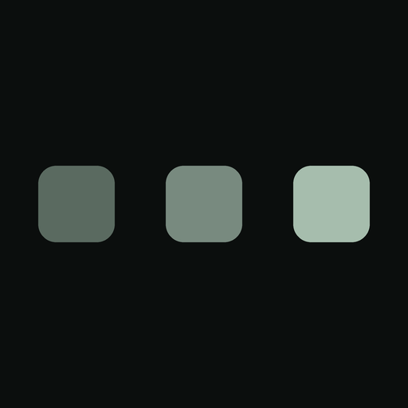

  

  
  
  
  
  

 

## whoami

I read Industrial & Systems Engineering at **IIT Kharagpur**, class of 2028, and I run operations at
[**Amoh**](https://amoh.ai), the medical AI research lab. The rest of my time goes where statistics meets
markets: forecasting, factor research, optimisation, and the occasional 3 a.m. contest problem. Right now I am
working through stochastic calculus, econometrics, and market microstructure.

I advise the **Kharagpur Data Analytics Group**, having run it as Executive Head the year before.

> कर्मण्येवाधिकारस्ते मा फलेषु कदाचन ।
> मा कर्मफलहेतुर्भूर्मा ते सङ्गोऽस्त्वकर्मणि ॥
>
> *You have a right to the work alone, never to its fruits.*

## building

  

<table>
<tr>
<td width="72" valign="top"></td>
<td valign="top">

Frontier models pass medical exams and still stall on the actual work: committing to a diagnosis, choosing what to
rule out first, admitting when the evidence is thin. **Amoh** builds the environments, evals and feedback traces that
train models on hard cases from real clinics, verified against what was feasible for each patient, with 10+ clinic
partners across the US. I run operations. Plenty to read. Very little to practise.

[amoh.ai](https://amoh.ai) · [@amoh-ai](https://github.com/amoh-ai) · [research@amoh.ai](mailto:research@amoh.ai) · [we are hiring](https://amoh.ai/about.html#careers)

</td>
</tr>
</table>

## stack

  

## track record

  

<b>the same thing, with the detail filled in</b>

 

| when | where | what |
|:-----|:------|:-----|
| **2027** | **L.E.K. Consulting** | Incoming **Summer Associate**. |
| **2026-27** | **KDAG**, IIT Kharagpur | **Advisor** to the Kharagpur Data Analytics Group, steering curriculum and project direction. |
| **2026 →** | **Amoh** | **Operations** at the medical AI research lab. RL environments, evals and data for models that do clinical work. |
| **2025-26** | **KDAG**, IIT Kharagpur | **Executive Head**, running the data science curriculum, projects and inductions under the Technology Students' Gymkhana. |
| **May to Jul 2025** | **PharmEasy** *(Threpsi Solutions)* | Summer intern in Bangalore, a ten week project engagement. |
| **Sep to Oct 2024** | **Myntra** | **Strategy Intern**. Market and competitive analysis for a shoe care brand launch: pricing, positioning, portfolio, go to market. |
| **Jul to Nov 2024** | **Seventh Triangle Consulting** | **Research & Development Intern**, four months of applied research and analysis. |
| | **WorldQuant** | **Gold Level**, WorldQuant Challenge. |

## selected work

  
  
  
  
  
  

  <a href="https://github.com/Madmins07?tab=repositories"><b>all repositories</b></a>

## positions

  

## a day at the desk

  

## metrics

  
  

  

## frequencies

  

## contributions

  <picture>
    <source media="(prefers-color-scheme: dark)" srcset="https://raw.githubusercontent.com/Madmins07/Madmins07/output/github-snake-dark.svg"/>
    <source media="(prefers-color-scheme: light)" srcset="https://raw.githubusercontent.com/Madmins07/Madmins07/output/github-snake.svg"/>
    
  </picture>

## elsewhere

 

  

